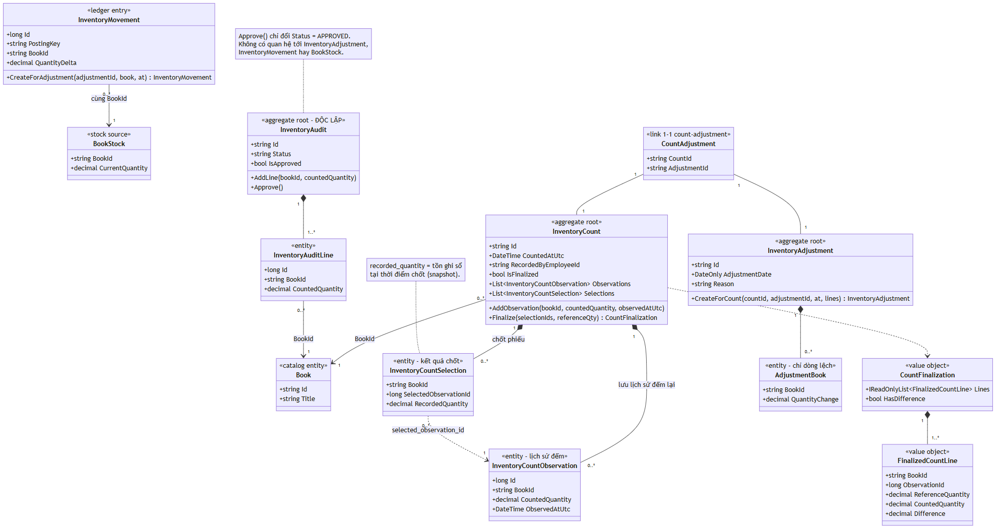
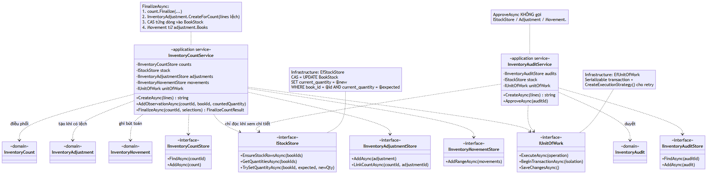
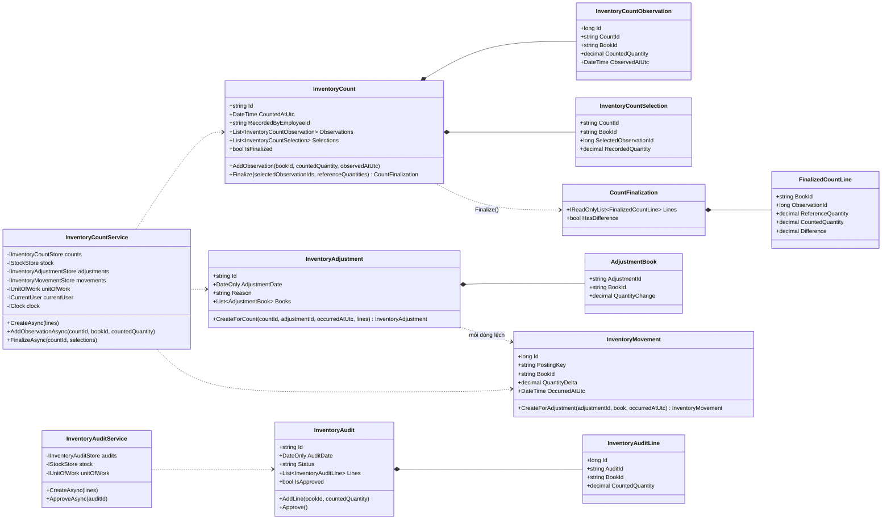
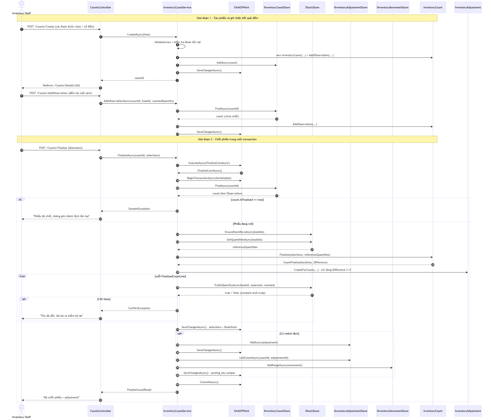
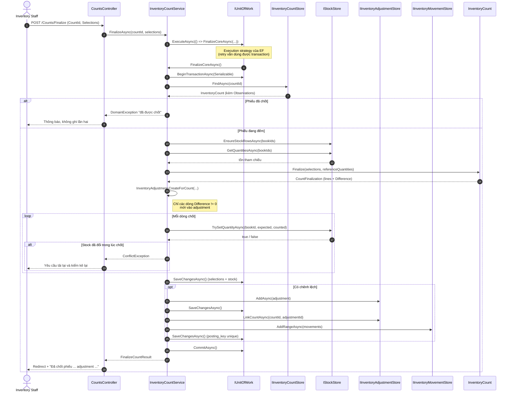
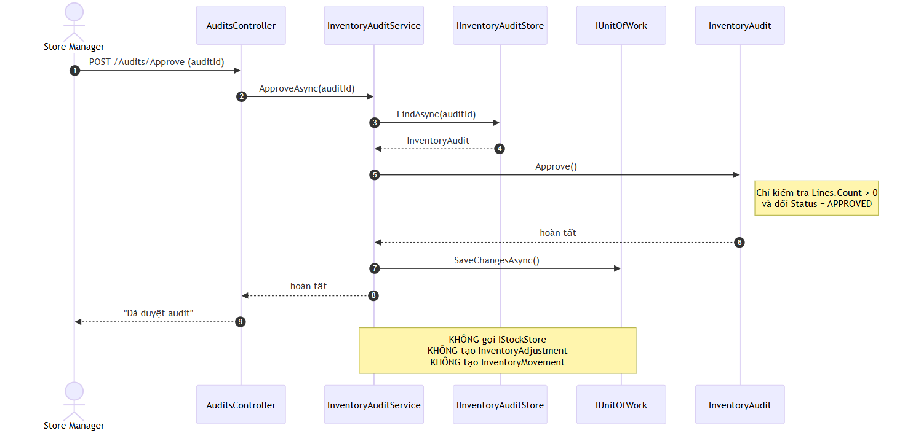
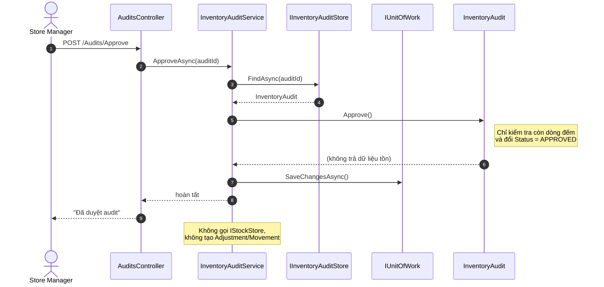

# SWD392 BookSales — Module Mua hàng & Tồn kho (Kiệt)

Phần được giao: **Kiệt — mua hàng và tồn kho**, phụ trách mô hình của **UC04, UC05, UC06, UC07, UC08, UC09, UC13, UC14**, trong đó luồng chính được code đầy đủ là **UC07 Record Inventory Count** (actor: Inventory Staff).

Tài liệu này là phần thuyết minh và kịch bản demo: kiến trúc, ranh giới lưu dữ liệu, quy tắc nghiệp vụ, Class Diagram, Sequence Diagram, cách chạy và bằng chứng kiểm thử.

---

## 1. Cách chạy

### 1.1. Chuẩn bị database

1. Chạy script `SWD392_BookSales_Management.sql` trên SQL Server local (database `SWD392_BookSales_3NF_REVIEW_20261027`).
2. Kiểm tra connection string trong `src/BookSalesManagement.Web/appsettings.json`:

```json
"BookSales": "Server=localhost;Database=SWD392_BookSales_3NF_REVIEW_20261027;Trusted_Connection=True;TrustServerCertificate=True;MultipleActiveResultSets=True"
```

### 1.2. Chạy ứng dụng

```bash
dotnet build BookSalesManagement.sln
dotnet run --project src/BookSalesManagement.Web --urls http://localhost:5080
```

Mở `http://localhost:5080`. Chọn **tài khoản demo** ở `/Session`:

| Tài khoản | Vai trò | Dùng để demo |
| --- | --- | --- |
| `demo.inventory` | Inventory Staff | UC07: tạo phiếu, đếm lại, chốt phiếu |
| `demo.manager` | Store Manager | UC14: xem/duyệt Audit, không được tạo Count/Audit |
| `demo.sales` | Sales Staff | Kiểm tra 403 khi vào module tồn kho |

> Demo session dùng cookie `swd392_demo_account` chỉ để minh họa kiểm tra quyền **phía server**. Hùng sẽ thay bằng Login/permission chung của nhóm; các controller đã gắn `[RequirePermission(...)]` nên khi ghép Login không phải sửa luồng nghiệp vụ.

### 1.3. Chạy test

```bash
dotnet test tests/BookSalesManagement.Tests/BookSalesManagement.Tests.csproj
```

Kết quả hiện tại: **24/24 test pass**.

---

## 2. Kiến trúc và ranh giới lưu dữ liệu

```
BookSalesManagement.Web            MVC controller + Razor view
        │  gọi service qua DI
BookSalesManagement.Application    InventoryCountService, InventoryAuditService,
        │                          DTO, interface IUnitOfWork/IStockStore/...
        │  gọi hành vi nghiệp vụ
BookSalesManagement.Domain         InventoryCount, InventoryAdjustment,
        │                          InventoryAudit, InventoryMovement, BookStock
        │  được map bởi
BookSalesManagement.Infrastructure EF Core DbContext, store/repository, query service
```

Điểm quan trọng khi bảo vệ:

- **Domain không biết EF Core, SQL hay ASP.NET.** `InventoryCount` tự bảo vệ bất biến (không chốt hai lần, không nhận số âm, mỗi sách chỉ có một selection khi chốt).
- **Application chỉ phụ thuộc abstraction.** `InventoryCountService` làm việc với `IInventoryCountStore`, `IStockStore`, `IInventoryMovementStore`, `IUnitOfWork` — không tham chiếu `DbContext`.
- **Infrastructure là nơi duy nhất biết database.** Các store trong `src/BookSalesManagement.Infrastructure/Persistence/` map aggregate sang bảng thật và dịch lỗi SQL thành `ConflictException`.
- **Controller chỉ điều phối HTTP**: validate form, gọi service, đặt `TempData` thông báo, redirect. Không chứa quy tắc chênh lệch.

### 2.1. Bảng ↔ class

| Class | Bảng | Ghi chú |
| --- | --- | --- |
| `InventoryCount` | `InventoryCount` | Header phiếu đếm |
| `InventoryCountObservation` | `InventoryCountObservation` | Từng lần đếm, giữ lịch sử đếm lại |
| `InventoryCountSelection` | `InventoryCountSelection` | Kết quả được chọn khi chốt; có `recorded_quantity` là snapshot tồn lúc chốt |
| `InventoryAdjustment` | `InventoryAdjustment` | Một adjustment cho một phiếu |
| `AdjustmentBook` | `AdjustmentBook` | Chỉ các dòng lệch |
| `CountAdjustment` | `CountAdjustment` | Liên kết 1–1 count → adjustment |
| `InventoryMovement` | `InventoryMovement` | Bút toán tồn; `posting_key` unique |
| `InventoryAudit` / `InventoryAuditLine` | `InventoryAudit` / `InventoryAuditLine` | Audit độc lập, không có tác động tồn |

`InventoryCount.IsFinalized` được tính từ `Selections.Count > 0` và được **ignore** khi map EF — trạng thái chốt là dữ kiện nghiệp vụ, không phải cột dư thừa.

---

## 3. Design Class Diagram

Bản đã xuất để chèn báo cáo (nguồn Mermaid nằm trong `docs/diagrams/*.mmd`):

**Hình 3.1 — Domain model (Count vs Audit):**



**Hình 3.2 — Application service và abstraction lưu dữ liệu:**



Sơ đồ Mermaid rút gọn (cùng nội dung, dùng khi cần chỉnh sửa):



**Count khác Audit ngay trong mô hình:**

- `InventoryCount` có `Observations` (lịch sử đếm), `Selections` (kết quả chốt) và tạo ra `InventoryAdjustment` + `InventoryMovement`.
- `InventoryAudit` chỉ có `Lines` và `Status`; `Approve()` chỉ đổi `DRAFT → APPROVED`. Audit **không có** tham chiếu tới Adjustment, Movement hay Stock.
- Hai aggregate không kế thừa/composition lẫn nhau; dùng chung khái niệm "đếm" nhưng là hai quy trình độc lập.

---

## 4. Sequence Diagram — UC07 Finalize (luồng chính)



Nguồn Mermaid:



Điểm cần nói khi demo:

1. Toàn bộ đọc tồn → tính chênh lệch → ghi stock → ghi adjustment → ghi movement nằm trong **một transaction Serializable**.
2. `TrySetQuantityAsync` là **compare-and-swap** (`UPDATE ... WHERE current_quantity = @expected`), nên nếu người khác nhập/xuất kho trong lúc đang chốt thì phiếu bị từ chối thay vì ghi đè.
3. Adjustment và movement chỉ được tạo **sau khi mọi dòng stock đã CAS thành công**; lỗi giữa chừng sẽ rollback cả transaction.
4. `ExecuteAsync` bọc ngoài transaction để tương thích `EnableRetryOnFailure(3)` của SQL Server (retry strategy không cho phép transaction do người dùng tự mở nếu không bọc đúng cách).

### 4.1. Sequence Diagram — Audit approve (không tác động tồn)



Nguồn Mermaid:



Đây là bằng chứng trực tiếp cho quy tắc: **phê duyệt Audit chỉ xác nhận kết quả, không cập nhật tồn và không tạo Adjustment**. `InventoryAuditService` thậm chí không có dependency `IInventoryAdjustmentStore`/`IInventoryMovementStore`.

---

## 5. Quy tắc nghiệp vụ và lỗi quan trọng

| Quy tắc | Cài đặt | Bằng chứng |
| --- | --- | --- |
| Count độc lập với Audit, nhiều Book | `InventoryCountService.CreateAsync` nhận 1..n dòng, kiểm tra trùng Book | `/Counts/Create` |
| Đếm lại lưu lịch sử | Mỗi lần ghi tạo `InventoryCountObservation` mới; không sửa observation cũ | Khối "Ghi thêm kết quả đếm" ở `/Counts/Details` |
| Chốt cập nhật tồn theo số đếm | CAS `TrySetQuantityAsync` cho từng dòng | `InventoryCountService.FinalizeCoreAsync` |
| Một Adjustment chứa mọi dòng lệch | `InventoryAdjustment.CreateForCount` lọc `Difference != 0` và gom vào một aggregate | `/Adjustments` |
| Không ghi cùng chênh lệch hai lần | `IsFinalized` guard + PK `InventoryCountSelection` + unique `CountAdjustment.adjustment_id` + unique `InventoryMovement.posting_key` | Test `Finalize_SecondTime_IsRejectedWithoutPostingAgain` |
| Audit approve không đổi tồn | `InventoryAudit.Approve()` chỉ đổi Status; service không có store tồn/adjustment | Test `Approve_OnlyConfirmsResultsAndLeavesStockUntouched` |
| Không nhận số lượng âm | Domain + service + controller đều validate | Test `Create_WithNegativeQuantity_IsRejected` |

### Lỗi quan trọng: chốt phiếu hai lần

Kịch bản: người dùng bấm **Chốt phiếu** lần hai, hoặc request bị gửi lặp.

Luồng chặn:

1. `InventoryCountService.FinalizeCoreAsync` đọc lại phiếu; nếu `count.IsFinalized` → ném `DomainException` với thông báo *"Phiếu kiểm kê đã được chốt. Không ghi lại cùng chênh lệch lần hai."*
2. `InventoryCount.Finalize` cũng có `EnsureOpen()`; toàn bộ dòng được validate trước khi thêm `Selections`, nên một lần chốt lỗi không để lại trạng thái dở dang.
3. Nếu hai request thật sự chạy song song, transaction Serializable + khóa của `InventoryCountSelection`/`CountAdjustment`/`posting_key` unique đảm bảo chỉ một request commit; request còn lại nhận `ConflictException` từ `EfUnitOfWork`.
4. Kết quả: **một phiếu chỉ tạo tối đa một Adjustment**, và mỗi dòng lệch chỉ sinh đúng một `InventoryMovement`.

Đã kiểm chứng trên UI: sau khi chốt, POST lặp lại hiển thị đúng thông báo lỗi và số adjustment/movement không tăng.

---

## 6. Kịch bản demo (nhiều Book, có dòng khớp và dòng lệch)

Dữ liệu seed có các sách `DEMO-20261027-B01`, `B03`, `B09`.

1. Đăng nhập demo bằng tài khoản Inventory Staff (`/Session`).
2. Vào **Kiểm kê → Tạo phiếu**.
3. Chọn 3 sách và nhập:

   | Sách | Tồn ghi sổ | Số đếm | Chênh lệch |
   | --- | --- | --- | --- |
   | `DEMO-20261027-B01` | 43 | **45** | **+2** |
   | `DEMO-20261027-B03` | 18 | **17** | **-1** |
   | `DEMO-20261027-B09` | 18 | 18 | 0 (khớp) |

4. Bấm **Tạo phiếu** → trang chi tiết hiển thị 3 observation, trạng thái *Đang đếm*, chưa có adjustment.
5. (Tùy chọn) Ghi thêm một kết quả đếm lại cho `B01` để thấy lịch sử nhiều observation.
6. Chọn một kết quả cho từng sách → nút **Chốt phiếu** bật khi đủ 3 sách; phần xem trước hiển thị `+2`, `-1`, `0`.
7. Bấm **Chốt phiếu** và xác nhận:
   - Thông báo tạo adjustment duy nhất, ví dụ lần chạy minh họa: `ADJ-20261027110613-E9EA1F`.
   - Trang kết quả: `B01` 43 → 45, `B03` 18 → 17, `B09` 18 → 18.
   - Chỉ `B01` và `B03` xuất hiện trong adjustment; `B09` ghi *"Khớp · không adjustment"*.
8. Mở link adjustment → thẻ `ADJ-...` được highlight, chỉ có 2 dòng lệch.
9. Bấm **Chốt phiếu** lần nữa (hoặc POST lại) → thông báo lỗi, không sinh adjustment/movement thứ hai.
10. Đăng nhập Store Manager → **Audit**: tạo/xem một đợt audit có dòng lệch, bấm **Duyệt**. Tồn kho và số movement không đổi; audit chỉ chuyển sang `APPROVED`.

Kiểm tra nhanh bằng SQL:

```sql
SELECT movement_id, posting_key, book_id, quantity_delta
FROM InventoryMovement
ORDER BY movement_id DESC;

SELECT adjustment_id, book_id, quantity_change
FROM AdjustmentBook
WHERE adjustment_id = 'ADJ-20261027110613-E9EA1F';

SELECT book_id, current_quantity
FROM BookStock
WHERE book_id IN ('DEMO-20261027-B01', 'DEMO-20261027-B03', 'DEMO-20261027-B09');
```

Kết quả mong đợi: đúng 1 adjustment với 2 dòng lệch, đúng 2 movement, `posting_key` dạng `ADJ-<timestamp>-<bookId>` (không lặp tiền tố `ADJ-`).

> Nếu database đang còn dữ liệu demo của lần chạy trước (ví dụ phiếu `CNT-20261027110555-1C2E3D` và adjustment `ADJ-20261027110613-E9EA1F`), tồn hiện tại sẽ là 45/17/18. Khi đó hoặc chạy lại script SQL để reset về seed 43/18/18, hoặc dùng chính tồn đang hiển thị trên màn hình Tổng quan và nhập số đếm lệch tương ứng.

---

## 7. OOP / abstraction thể hiện ở đâu

- **Hành vi nghiệp vụ nằm trong domain, không nằm ở service**: `InventoryCount.Finalize`, `InventoryAdjustment.CreateForCount`, `InventoryMovement.CreateForAdjustment`, `InventoryAudit.Approve`. Service chỉ điều phối thứ tự gọi và transaction.
- **Composition**: `InventoryCount` sở hữu `Observation`/`Selection`; `InventoryAdjustment` sở hữu `AdjustmentBook`; `InventoryAudit` sở hữu `InventoryAuditLine`. Không truy cập trực tiếp collection từ bên ngoài để sửa — chỉ qua method.
- **Dependency qua interface**: service phụ thuộc `IStockStore`, `IUnitOfWork`, `IClock`, `ICurrentUser`; nhờ đó test dùng fake in-memory và có thể thay implementation khi ghép module của Hưng/Nghĩa.
- **Single responsibility**: controller lo HTTP; service lo use case/transaction; domain lo bất biến; EF store lo SQL; query service lo đọc báo cáo.
- **Value object/thuật ngữ rõ nghĩa**: `FinalizedCountLine`, `CountFinalization`, `AdjustmentBook` giúp chênh lệch được tính một lần (`CountedQuantity - ReferenceQuantity`) và dùng thống nhất ở service, movement và UI.
- **Không leak persistence**: domain không có navigation tới `Book`/`BookStock`; nó chỉ giữ `BookId` và nhận tồn tham chiếu qua tham số, nên có thể test thuần không cần database.

---

## 8. Kiểm thử tự động

`tests/BookSalesManagement.Tests` gồm 24 test:

- **Domain**
  - Chốt phiếu lần hai bị từ chối.
  - Không thêm observation sau khi chốt.
  - Số lượng âm bị từ chối.
  - Thiếu selection cho một sách → không chốt, không để lại selection dở dang.
  - Một adjustment chỉ chứa dòng lệch; không lệch → không tạo adjustment.
  - `posting_key` không lặp tiền tố `ADJ-`.
  - Audit approve chỉ đổi status; approve lần hai/không có dòng bị từ chối.
- **Application (fake store in-memory)**
  - Finalize tạo đúng 1 adjustment, đúng các dòng lệch, cập nhật đủ tồn.
  - Không lệch → không adjustment, không movement.
  - Finalize lần hai không ghi lặp.
  - Thiếu selection → lỗi, không ghi gì.
  - Stock thay đổi đồng thời (CAS fail) → `ConflictException`, không adjustment/movement.
  - Tạo Count/Audit với số âm, sách không tồn tại, sách trùng → lỗi.
  - Audit approve không gọi CAS tồn, không đổi tồn.

---

## 9. Ghi chú sử dụng AI

- AI hỗ trợ đọc file phân công và schema, gợi ý cấu trúc lớp, viết khung UI/test, và rà lỗi biên dịch.
- Phần nghiệp vụ cốt lõi (ý nghĩa `recorded_quantity`, quy tắc một adjustment, Count ≠ Audit, chống ghi lặp) được kiểm tra lại với tài liệu và dữ liệu thật trong database; mọi thay đổi đều được chạy thử trên UI và đối chiếu SQL.
- Các lỗi phát hiện trong quá trình làm và đã sửa: posting key bị lặp `ADJ-ADJ-`, EF retry strategy không tương thích transaction tự mở, LINQ không dịch được trên projection `DemoAccount`, và validate finalize để lại state dở dang (đã sửa thành validate toàn bộ trước khi ghi selection).
- Tài liệu này do nhóm biên tập lại để bảo vệ; không dùng nguyên văn đầu ra của AI làm nội dung thuyết trình.

---

## 10. Phạm vi đã hoàn thành / chưa làm

Đã có:

- UC07 đầy đủ: tạo phiếu nhiều sách, đếm lại, chọn kết quả, chốt, adjustment, movement, chống chốt lặp, xử lý conflict.
- UC13/UC14 (phần tồn kho): xem adjustment, movement, đối chiếu tồn; xem/duyệt Audit (duyệt không đổi tồn).
- UC04–UC06: màn hình read-only PO/receipt/provider từ dữ liệu mẫu.
- Kiểm tra quyền server-side theo permission, trang 403, tài khoản demo.

Chưa triển khai (nằm trong phạm vi mô hình, cần thống nhất thêm):

- Sửa/hủy phiếu đếm, đính kèm minh chứng.
- Nhận hàng (Goods Receipt) làm thay đổi tồn; hiện chỉ hiển thị read-only.
- Audit đầy đủ vòng đời (tạo nhiều đợt, khóa kỳ, log thay đổi).
- Login/permission thật (Hùng) và báo cáo tồn (Nghĩa).
