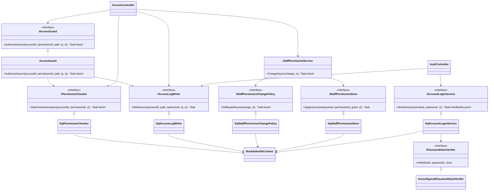
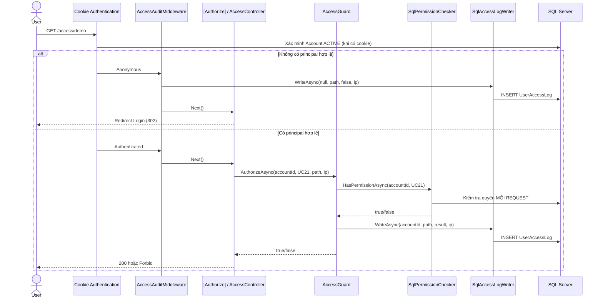

# Hùng — Access & Audit (SWD392)

## Phạm vi và bằng chứng

- UC12: Store Manager cập nhật quyền nhân viên theo chính sách được duyệt; System Admin có mọi quyền.
- Role và permission là dữ liệu **từ SQL Server**, không tự phát minh bảng RBAC mới.
- Login dùng cookie ASP.NET Core, cột `Account.password_hash`; thuật toán hash / cấp mật khẩu mẫu **chưa chốt** nên ứng dụng vẫn **không cho đăng nhập**.
- Phân quyền đọc database trên **mỗi lần kiểm tra**, không cache danh sách quyền vào cookie.
- `UserAccessLog`: `account_id`, `occurred_at_utc`, `request_path`, `was_authorized`, `client_ip`.
- Quản lý nhật ký: Admin xem mọi bản ghi; Manager xem nhật ký tài khoản nhân viên, loại nhật ký của System Admin và lượt truy cập chưa định danh khỏi màn Manager.
- Bằng chứng đã chạy trên máy người phụ trách trước khi thêm gói cuối: 14/14 test nền tảng và unit, 5/5 HTTP endpoints, UC12 database 6/6 với transaction rollback. **Các thay đổi trong gói cuối phải build và test lại** trên máy có .NET 8.

## Cấu hình Local (không commit)

File `src/BookSales.Web/appsettings.Local.json` chứa kết nối DB và cấu hình sau:

```json
"Access": {
  "Uc12PermissionId": "DEMO-20261027-UC12",
  "DemoPermissionId": "DEMO-20261027-UC21",
  "ManagerEditablePermissionIds": [],
  "ManagerEditableTargetRoleCodes": []
}
```

`ManagerEditablePermissionIds` và `ManagerEditableTargetRoleCodes` **đều rỗng** tới khi nhóm phê duyệt. Không điền đoán mã từ tên UC. Dù UI lỗi, `SqlStaffPermissionChangePolicy` vẫn từ chối thay đổi ngoài hai danh sách.

## Lớp và trách nhiệm

| Lớp | Trách nhiệm |
| --- | --- |
| `Account`, `Employee`, `Permission`, `EmployeePermission`, `UserAccessLog` | Mô hình dữ liệu đúng các bảng SQL |
| `BookSalesDbContext` | EF Core mapping các bảng |
| `SqlPermissionChecker` / `IPermissionChecker` | Tra quyền trực tiếp từ DB; chặn DISABLED và quyền không tồn tại |
| `SqlAccessLogWriter` / `IAccessLogWriter` | Lưu bản ghi vào UserAccessLog bằng scope DbContext riêng |
| `AccessGuard` / `IAccessGuard` | Kiểm tra và ghi log allow/deny phía server |
| `AccessAuditMiddleware` | Ghi log yêu cầu ẩn danh vào endpoint bảo vệ trước khi `[Authorize]` redirect |
| `StaffPermissionService` | Điều phối policy → store; không tự định nghĩa business rules |
| `SqlStaffPermissionChangePolicy` | Kiểm tra actor, target, quyền, manager self-edit, các danh sách được duyệt |
| `SqlStaffPermissionStore` | Cấp/thu hồi quyền bằng EF, idempotent |
| `AccessController` | GET quản lý quyền, POST đổi quyền, demo chức năng bảo vệ, GET access logs |
| `AuthController` | Login form, logout, cookie sign-in (khi verifier hợp lệ được chốt) |
| `IPasswordHashVerifier` | Điểm mở để triển khai thuật toán hash được nhóm xác nhận |
| `UnconfiguredPasswordHashVerifier` | Luôn từ chối mật khẩu, không mở lối tắt khi thiếu quyết định |

## Class Diagram (code thực tế)



## UC12 Sequence Diagram (POST /access/permissions)

```mermaid
sequenceDiagram
    actor Actor as Admin/Store Manager
    participant Web as AccessController
    participant Auth as IPermissionChecker
    participant UC12 as StaffPermissionService
    participant Policy as SqlStaffPermissionChangePolicy
    participant Store as SqlStaffPermissionStore
    participant DB as SQL Server / BookSalesDbContext

    Actor->>Web: POST quyền, AntiForgery Token
    Web->>Auth: HasPermissionAsync(accountId, UC12)
    Auth->>DB: Kiểm tra Account ACTIVE + Role/EmployeePermission
    DB-->>Auth: true/false
    Auth-->>Web: canAccess
    alt Không có quyền UC12
      Web->>DB: Ghi UserAccessLog(denied)
      Web-->>Actor: Forbid
    else Có quyền UC12, dữ liệu hợp lệ
      Web->>DB: BEGIN TRANSACTION
      Web->>UC12: ChangeAsync(actor, target, permission, grant)
      UC12->>Policy: IsAllowedAsync(change)
      Policy->>DB: Kiểm tra role, self-edit, scope đã duyệt
      DB-->>Policy: allow/deny
      alt Chính sách cho phép
        UC12->>Store: ApplyAsync(target, permission, grant)
        Store->>DB: INSERT/DELETE EmployeePermission
      end
      UC12-->>Web: true/false
      Web->>DB: INSERT UserAccessLog(true/false) CÙNG TRANSACTION
      Web->>DB: COMMIT (rollback nếu lỗi)
      Web-->>Actor: Redirect + thông báo kết quả
    end
```

## Sequence Diagram — HTTP access và audit



## Dữ liệu kiểm thử đã xác minh

- Database mẫu `SWD392_BookSales_3NF_REVIEW_20261027`, server `SQLEXPRESS` tại môi trường của nhóm.
- Các tài khoản mẫu gồm admin, manager, sales A/B, inventory, disabled. Các `password_hash` lúc kiểm tra đều `NULL` nên không thể dùng giao diện để login thực.
- Permission Checker: 8/8 trường hợp từ DB thật; AccessLogWriter ghi/rollback OK, 6 bản ghi trước và sau.
- UC12: Admin cấp UC21 cho Sales B, lần kiểm tra kế tiếp cho phép; thu hồi, lần kiểm tra kế tiếp từ chối; mọi thay đổi trong transaction đã rollback, 6/6 PASS.
- Route HTTP trước batch cuối: `/health` 200, `/access/login` 200, `/access/permissions` 302, `/access/demo` 302, `/access/logs` 302.

## Việc còn CHỜ XÁC NHẬN (không triển khai giả)

1. Thuật toán hash mật khẩu, cách sinh hash và cấp mật khẩu demo cho 6 account. Chỉ sau khi chốt mới thay DI `IPasswordHashVerifier` và cập nhật database bằng quy trình được nhóm duyệt. Không commit mật khẩu hoặc secret.
2. Danh sách chính xác `ManagerEditablePermissionIds` và nhóm vai trò nhân viên được chỉnh `ManagerEditableTargetRoleCodes` (nếu cần nhóm bổ sung quy tắc về Manager khác, phải được chốt rõ). Không cấp quyền theo phỏng đoán.

## Cách demo sau khi nhóm chốt

1. Đăng nhập bằng account Admin đã có hash hợp lệ.
2. Vào `/access/permissions`; chọn Sales B và UC21, cấp quyền.
3. Với cùng phiên Sales B đang đăng nhập, gọi `/access/demo` trên request mới → thành công.
4. Admin thu hồi UC21; Sales B gọi lại `/access/demo` → từ chối ngay, không cần đăng nhập lại.
5. Vào `/access/logs`: kiểm tra account, path, UTC, outcome, IP; so sánh Manager/Admin; thử DISABLED và Manager sửa chính mình.
6. Khi trình bày bảo vệ, mở Class/Sequence Diagram trong tài liệu để giải thích ranh giới Application / Infrastructure / Web.

## Lưu ý kỹ thuật

- `AccessAuditMiddleware` chỉ ghi lại lượt anonymous đối với các route bảo vệ đã có (`permissions`, `demo`, `logs`, `logout`), không ghi mọi request công khai để tránh tăng log vô hạn.
- POST UC12 dùng chung scoped `BookSalesDbContext` cho thay đổi quyền và log; chúng nằm trong **một transaction SQL**. Các trường hợp bị từ chối tại bước kiểm tra UC12 được ghi qua writer độc lập.
- Các tình huống ghi log không thành công sẽ ném exception thay vì cho phép tiếp tục xử lý. Không biến lỗi lưu log thành thành công giả.
- Với hệ thống lớn, cần thiết kế rõ retry, rate-limit Login, log retention, phân trang/phân quyền đọc log, và xử lý cạnh tranh thay đổi quyền. Những thứ này chưa được khẳng định là phạm vi bài nhóm.
- File `appsettings.Local.json` là secret và đã được `.gitignore` bỏ qua; tuyệt đối không commit.
- Chỉ làm việc trên branch `feature/hung-access-audit`; không push hoặc merge `main` từ script.
